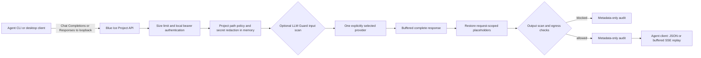

# Blue Ice Project


Blue Ice Project is a local, OpenAI-compatible gateway intended to add configurable checks between coding clients and one explicitly selected model provider. It is an early-stage defense-in-depth tool, not a guarantee of security, confidentiality, or zero data retention.

## What it does

The Python service exposes `GET /v1/models`, `POST /v1/chat/completions`, and a native `POST /v1/responses` route on loopback. Responses forwarding is enabled for the built-in `openai` provider or a custom provider with an explicitly registered `responses_url`; chat-only providers return `501` rather than receiving a translated request. It applies byte limits, project-path checks, in-memory secret redaction, output inspection, optional placeholder restoration, and metadata-only audit. Both protocols are buffered before delivery; for Responses SSE, all parsed frame text is inspected and frames after the terminal completion event are rejected before replay. This adds latency and does not provide incremental streaming or establish full Codex conformance.

Built-in Chat Completions destinations are OpenAI, OpenRouter, Groq, Google, Cerebras, and a loopback-only Ollama endpoint. Native Responses forwarding is available to OpenAI and to custom endpoints explicitly registered with `--responses-url`. A custom HTTPS Chat Completions endpoint is not assumed to support Responses. The provider URL is configuration, never request input. Provider selection is explicit; the proxy does not rotate keys or silently fail over to another provider.

The optional LLM Guard adapter is disabled by default. ProtectAI's upstream repository is archived and is no longer actively maintained. The optional extra is pinned to the last PyPI release verified for this project (`0.3.16`); install it explicitly with `python -m pip install '.[llm-guard]'` on Python 3.12, then set `llm_guard_enabled: true` in the private config. When enabled, scanner initialization or failure blocks the request. This dependency has no PyPI provenance metadata, so enabling it is an explicit operator risk decision. See [the LLM Guard notes](docs/llm-guard.md).

## Request flow



## Install and start

Requirements: Python 3.12 or newer. The optional TypeScript terminal client requires Node.js 20 or newer.

```sh
python -m venv .venv
. .venv/bin/activate
python -m pip install --upgrade pip
python -m pip install .
blue-ice init --project-root /absolute/path/to/your/project --provider openrouter
blue-ice start
```

`init` creates local policy and bearer-token files under `~/.aegis/`. This legacy storage namespace is retained for local-data compatibility; Blue Ice Project and `blue-ice` are the product and primary command names. The token is stored in a separate owner-only file. The provider API key is never accepted as a CLI argument or written to YAML. Configure a provider-specific environment variable in the same shell that starts the service, or choose the OS keyring when prompted by `init`:

```sh
export AEGIS_OPENROUTER_API_KEY='your-provider-key'
blue-ice start
```

Provider-key variables retain the legacy `AEGIS_` prefix: `AEGIS_OPENAI_API_KEY`, `AEGIS_OPENROUTER_API_KEY`, `AEGIS_GROQ_API_KEY`, `AEGIS_GOOGLE_API_KEY`, and `AEGIS_CEREBRAS_API_KEY`. Ollama does not require a cloud API key. A custom provider named `vendorx` uses `AEGIS_CUSTOM_VENDORX_API_KEY`. Prefer a protected secret manager or OS keyring over shell history and avoid putting credentials in project files.

For custom providers, register only an endpoint you trust:

```sh
blue-ice provider add vendorx --url https://api.vendor.example/v1/chat/completions --model my-model
# Add --responses-url https://api.vendor.example/v1/responses only if the provider supports it.
blue-ice provider use vendorx --model my-model
```

The URL is stored in the local policy file; the key remains in the selected environment or OS keyring. Custom provider destinations are currently DNS-checked for public IPs but are not pinned to those addresses for the lifetime of the HTTP connection. DNS rebinding therefore remains a residual SSRF risk; use only endpoints you control and trust.

## TypeScript / Node terminal client

The Node client is a plain-text command front end. It uses ordinary labels and commands, without decorative terminal symbols or ANSI styling. It does not handle provider API keys.

```sh
cd cli-node
npm ci
npm run build
npm link
blue-ice help
blue-ice models
```

The Python package must also be installed so the Node client can delegate policy and service commands. `blue-ice models` reads the local bearer token from `~/.aegis/local-token` or `BLUE_ICE_TOKEN_FILE` and calls only the loopback service.

## Connecting an OpenAI-compatible client

Set the client base URL to `http://127.0.0.1:8080/v1` and its local API key/token to the contents of `~/.aegis/local-token`. The local token authenticates to Blue Ice Project; it is not a provider API key. If a client supports environment-based configuration, a common pattern is:

```sh
export OPENAI_BASE_URL='http://127.0.0.1:8080/v1'
export OPENAI_API_KEY="$(cat "$HOME/.aegis/local-token")"
```

Client configuration names and API protocols differ. Codex can target `/v1/responses` when the proxy uses the OpenAI provider or a custom provider with a native `responses_url` registered; see the [agent integration guide](docs/agent-integrations.md). The route has synthetic tests for request fields, continuation, tool outputs, auth, SSE event preservation, and size limits, but has not been tested with a live Codex CLI, desktop app, upstream provider account, or Codex Security CLI. Buffered event replay does not establish full Codex gateway conformance. Other listed clients generally use Chat Completions, but their authentication, tools, and model capabilities remain client-specific.

## Local policy and audit

The generated configuration is kept outside the project tree. `config.example.yaml` shows the supported fields and contains no API key. Review project path and `.privacyignore` settings before using an agent. The default rules reject references to common secret-bearing files; they are heuristics, not a complete data-loss-prevention system.

`blue-ice audit` displays a bounded number of metadata-only records. Audit files have a fixed size limit; when full, successful responses are withheld rather than returned without a recorded event. If a blocked or failed request cannot be recorded, the API returns `503 audit_unavailable` instead of silently returning its ordinary blocked/error response. Audit records can include provider identifiers, rule names, counts, timestamps, and latency, but should not include prompts, responses, credentials, or reconstructed secrets.

## Security and privacy limits

Blue Ice Project reduces some risks; it does not eliminate them. Secret detection is incomplete, and redaction can miss encoded, split, novel, or otherwise unrecognized secrets. The remaining request content is still sent to the selected provider, whose data handling and retention are governed by that provider and account. Provider privacy headers or request preferences are not proof of zero retention.

The service binds to loopback by default and requires a local bearer token. Do not expose it to a LAN or public network without a separate threat review and suitable access controls. A local process with access to the token can call the proxy. There is no rate limiter, and local authentication is not a boundary against malware or a compromised user account. Review the specific residual risks in [the security review notes](docs/security-review.md).

Responses are buffered before forwarding to the client; large responses consume memory up to the configured limit. Native Responses requests go to the selected OpenAI or explicitly configured custom provider, where provider-side data controls apply; this gateway does not force `store: false` or guarantee zero retention. Requests using `previous_response_id` may rely on upstream state. Custom-provider DNS is validated but not pinned, so DNS rebinding is not fully mitigated. The proxy does not verify provider claims, inspect the provider's infrastructure, or guarantee that content checks catch prompt injection, malicious code, unsafe shell commands, or package confusion. Registry checks are opt-in because queried package names are sent to public registries. Unknown or unavailable registry results are risk signals, not proof of maliciousness.

LLM Guard is optional and upstream-archived. Enabling it does not provide a complete safety filter. An audit log can itself reveal operational metadata and should remain protected. Review bundled skills in `skills/` and `.agents/skills/` and license notices in `licenses/`; their presence does not install their tools or runtime dependencies.

## Development and checks

```sh
python -m pip install -e '.[dev]'
pytest
ruff check src tests
ruff format --check src tests
cd cli-node && npm ci && npm run build
```

This repository is an early review build. Automated tests and static checks cannot prove that the project is vulnerability-free. Report reproducible security issues without including real credentials or private prompt content.

## License and project review

Blue Ice Project code is MIT licensed; see [LICENSE](LICENSE). Bundled upstream skills retain their respective licenses and attribution in `licenses/`. The requested repository slug is `blu-ice-project`; public publication remains pending an explicit final confirmation after the source, secret, and artifact review.
